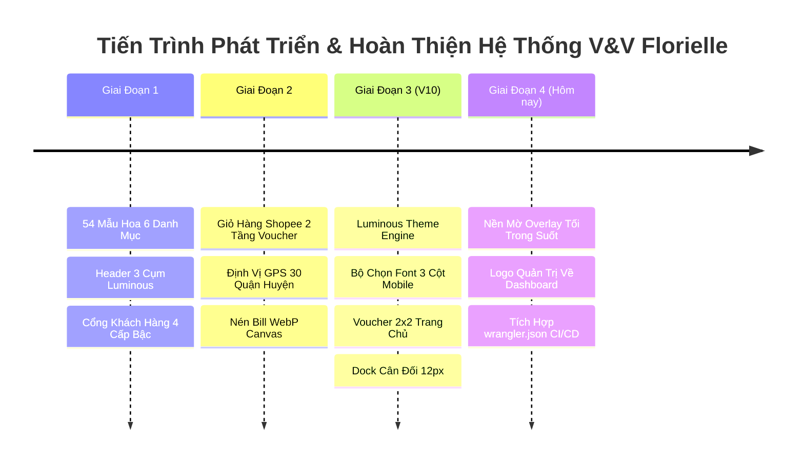
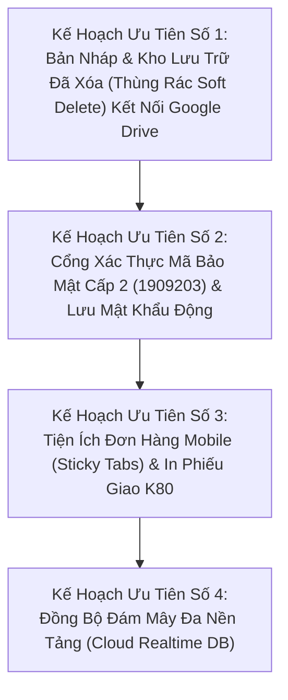

# 🌸 V&V FLORIELLE - HỒ SƠ BÀN GIAO TOÀN DIỆN KỸ THUẬT & TIẾN TRÌNH DỰ ÁN
## (Master Technical Handover, Progress Dossier & Work Roadmap v4.0)

> **Đơn vị chủ quản**: Tiệm Hoa Tươi Nghệ Thuật V&V Florielle  
> **Địa chỉ Showroom**: Số 105 Doãn Kế Thiện, Phường Mai Dịch, Quận Cầu Giấy, TP. Hà Nội  
> **Hotline / Zalo tư vấn 24/7**: 0906.721.442 / 0912.345.678  
> **Phiên bản hồ sơ**: **v4.0 – 17/11/2026** (Cập nhật toàn diện tiến trình thực tế, bàn giao hiện trạng kỹ thuật & kế hoạch công việc tiếp theo)  
> **Kho lưu trữ GitHub**: `https://github.com/VVFlorielle/vvflorielle.git` (Đồng bộ commit trên cả 2 nhánh `main` & `master`)  
> **Môi trường chạy**:  
> - **Local Development**: `http://localhost:5174/` (Vite dev server)  
> - **Production Web**: `https://vvflorielle.pages.dev` (Cloudflare Pages tự động kết nối qua `wrangler.json`)  

---

## 📑 MỤC LỤC HỒ SƠ BÀN GIAO

1. [I. Quy Định & Kỷ Luật Làm Việc Tối Cao (5 Điều Răn Bắt Buộc)](#i-quy-định--kỷ-luật-làm-việc-tối-cao-5-điều-răn-bắt-buộc)
2. [II. Ngăn Xếp Công Nghệ & Môi Trường Vận Hành](#ii-ngăn-xếp-công-nghệ--môi-trường-vận-hành)
3. [III. Sơ Đồ Cấu Trúc Mã Nguồn & Vai Trò Tập Tin](#iii-sơ-đồ-cấu-trúc-mã-nguồn--vai-trò-tập-tin)
4. [IV. Toàn Bộ Những Gì ĐÃ HOÀN THÀNH 100% Theo Tiến Trình Thực Tế](#iv-toàn-bộ-những-gì-đã-hoàn-thành-100-theo-tiến-trình-thực-tế)
   - [1. Phân hệ Cửa Hàng & Trải Nghiệm Khách Hàng](#1-phân-hệ-cửa-hàng--trải-nghiệm-khách-hàng)
   - [2. Giỏ Hàng Shopee Standard & Định Vị Cước Ship GPS Hà Nội](#2-giỏ-hàng-shopee-standard--định-vị-cước-ship-gps-hà-nội)
   - [3. Hệ Thống Quản Trị Kép Admin & Chủ Tiệm](#3-hệ-thống-quản-trị-kép-admin--chủ-tiệm)
   - [4. Bộ Máy Tinh Chỉnh Giao Diện & Trải Nghiệm V10 Vừa Hoàn Thành](#4-bộ-máy-tinh-chỉnh-giao-diện--trải-nghiệm-v10-vừa-hoàn-thành)
   - [5. Bộ Nén Ảnh WebP & Giải Phóng Bộ Nhớ Tự Động Sang Google Drive](#5-bộ-nén-ảnh-webp--giải-phóng-bộ-nhớ-tự-động-sang-google-drive)
5. [V. BÀN GIAO KẾ HOẠCH CÔNG VIỆC TIẾP THEO (ROADMAP TRIỂN KHAI)](#v-bàn-giao-kế-hoạch-công-việc-tiếp-theo-roadmap-triển-khai)
   - [Kế hoạch Ưu Tiên Số 1: Bản Nháp & Kho Lưu Trữ Đã Xóa (Thùng Rác Soft Delete) Kết Nối Google Drive](#kế-hoạch-ưu-tiên-số-1-bản-nháp--kho-lưu-trữ-đã-xóa-thùng-rác-soft-delete-kết-nối-google-drive)
   - [Kế hoạch Ưu Tiên Số 2: Cổng Xác Thực Mã Bảo Mật Cấp 2 (1909203) & Lưu Mật Khẩu Động](#kế-hoạch-ưu-tiên-số-2-cổng-xác-thực-mã-bảo-mật-cấp-2-1909203--lưu-mật-khẩu-động)
   - [Kế hoạch Ưu Tiên Số 3: Tiện Ích Đơn Hàng Mobile & In Hóa Đơn K80](#kế-hoạch-ưu-tiên-số-3-tiện-ích-đơn-hàng-mobile--in-hóa-đơn-k80)
   - [Kế hoạch Ưu Tiên Số 4: Đồng Bộ Đám Mây Đa Nền Tảng (Cloud Realtime DB)](#kế-hoạch-ưu-tiên-số-4-đồng-bộ-đám-mây-đa-nền-tảng-cloud-realtime-db)
6. [VI. Danh Mục Tài Khoản & Thông Số Vận Hành Tiệm Hoa](#vi-danh-mục-tài-khoản--thông-số-vận-hành-tiệm-hoa)

---

## I. QUY ĐỊNH & KỶ LUẬT LÀM VIỆC TỐI CAO (5 ĐIỀU RĂN BẮT BUỘC)

Mọi kỹ sư, lập trình viên hoặc AI Agent khi tham gia chỉnh sửa mã nguồn dự án V&V Florielle **PHẢI TUÂN THỦ TUYỆT ĐỐI 5 ĐIỀU RĂN KỶ LUẬT SAU ĐÂY**:

1. ⛔ **ĐIỀU CẤM TUYỆT ĐỐI (PROTECTED FILE)**:  
   * **KHÔNG ĐƯỢC PHÉP CHỈNH SỬA, THAY THẾ HOẶC XÓA BỎ BẤT KỲ DÒNG CODE NÀO TRONG TỆP [`src/components/Header.tsx`](file:///E:/V&VFlorielle/src/components/Header.tsx)**.  
   * Phần Header đã đạt chuẩn hoàn hảo về thiết kế 3 cụm kính mờ độc lập (*Luminous Island Clusters*), logo căn giữa chuẩn mực và chức năng tìm kiếm thời gian thực.
2. 🎯 **BẢO TỒN KHUNG VIỀN & TIÊU ĐỀ TRANG CHỦ**:  
   * Khung tiêu đề trang chủ và khung bao bọc đã được chốt cố định theo chuẩn nghệ thuật của tiệm. Tuyệt đối không tự ý co kéo, thêm lề, đổi padding hay di dời vị trí.
3. 📦 **ĐẢM BẢO CHUẨN MỰC KHO HOA (54 MẪU HOA)**:  
   * Website duy trì chính xác **54 mẫu hoa thật** chia đều cho **6 danh mục lớn** (mỗi danh mục đúng **9 mẫu hoa**). Không xóa mất ảnh hoặc hiển thị thiếu số lượng.
4. 📱 **CHUẨN MỰC GIAO DIỆN POPUP MODAL (DESKTOP VS MOBILE)**:  
   * **Trên Desktop**: Ưu tiên dạng ngang rộng rãi (`md:grid md:grid-cols-2`, `md:max-w-4xl`), hiển thị thông tin 2 cột trực quan.
   * **Trên Mobile**: Dạng khung dọc, căn giữa màn hình, khoảng cách đệm trên dưới cân đối, **không để đỉnh popup leo sát mép trên màn hình** và **không để chân popup chạm/đè lên thanh dock dưới đáy**.
   * **Nền mờ xung quanh popup**: Bắt buộc dùng **bóng kính trong suốt màu tối cao cấp** (`rgba(15, 23, 42, 0.55)` với `backdrop-filter: blur(14px)`) để khối popup màu trắng ngà nổi bật rực rỡ, không bị chìm vào nền trắng.
5. 🔍 **BÁO CÁO MINH BẠCH - KHÔNG TỰ Ý SỬA NGOÀI PHẠM VI**:  
   * Khi phát hiện lỗi hoặc được yêu cầu rà soát, phải lập báo cáo chi tiết, phân tích rõ nguyên nhân và giải pháp, chờ phê duyệt trước khi viết code sửa đổi.

---

## II. NGĂN XẾP CÔNG NGHỆ & MÔI TRƯỜNG VẬN HÀNH

- **Ngôn ngữ & Thư viện UI**: React 18.3.1, TypeScript 5.6.3, Vite 5.4.21.
- **Hệ thống tạo kiểu (Styling)**: Tailwind CSS 3.4 CDN, Custom Glassmorphism Engine ([`src/styles/glass.css`](file:///E:/V&VFlorielle/src/styles/glass.css)), Icons từ `lucide-react`.
- **Bộ máy màu sắc & Thương hiệu**: [themeEngine.ts](file:///E:/V&VFlorielle/src/utils/themeEngine.ts) (Luminous HSL Engine tính toán dynamic vibrant solid & glow), Google Fonts tích hợp 16 font chữ mềm mại nghệ thuật.
- **Xử lý âm thanh & nén ảnh**:
  - Web Audio API Chime Synth ([`audioNotification.ts`](file:///E:/V&VFlorielle/src/utils/audioNotification.ts)) - Tạo âm thanh chuông báo đơn mới mà không cần file mp3 ngoài.
  - HTML5 Canvas WebP Compressor ([`imageCompressor.ts`](file:///E:/V&VFlorielle/src/utils/imageCompressor.ts)) - Giảm kích thước ảnh bill chuyển khoản từ 3-10MB xuống ~80-120KB.
- **Hosting & CI/CD**: Cloudflare Pages kết nối tự động với GitHub qua [wrangler.json](file:///E:/V&VFlorielle/wrangler.json).

---

## III. SƠ ĐỒ CẤU TRÚC MÃ NGUỒN & VAI TRÒ TẬP TIN

```text
E:\V&VFlorielle\
├── index.html                           # Cấu trúc HTML gốc, nạp Google Fonts & Tailwind CDN
├── package.json                         # Danh mục dependencies (React, Vite, Lucide)
├── tsconfig.json                        # Cấu hình kiểm tra kiểu TypeScript nghiêm ngặt
├── wrangler.json                        # Cấu hình tự động triển khai Cloudflare Pages & Workers
├── vercel.json                          # Cấu hình điều hướng định tuyến SPA
├── src/
│   ├── main.tsx                         # Điểm khởi chạy ứng dụng React
│   ├── App.tsx                          # Điều phối View (Storefront vs Admin vs Owner vs Customer)
│   ├── context/
│   │   └── StoreContext.tsx             # Trái tim quản lý State toàn bộ hệ thống (3600+ dòng)
│   ├── types/
│   │   └── index.ts                     # Định nghĩa kiểu dữ liệu (Order, FlowerProduct, Customer...)
│   ├── data/
│   │   ├── mockData.ts                  # Dữ liệu 54 mẫu hoa thật, 6 danh mục, voucher, ngân hàng
│   │   └── hanoiLocations.ts            # Dữ liệu tọa độ GPS 30 quận/huyện Hà Nội tính cước ship
│   ├── components/
│   │   ├── Header.tsx                   # [BẢO VỆ TUYỆT ĐỐI] Header khách hàng 3 cụm bóng kính
│   │   ├── Footer.tsx                   # Chân trang thương hiệu, liên hệ, chính sách đổi trả 2H
│   │   ├── CartDrawer.tsx               # Giỏ hàng chuẩn Shopee: 2 tầng voucher, GPS cước ship, VietQR
│   │   ├── ProductDetailModal.tsx       # Popup xem chi tiết hoa, chọn số lượng, thiệp tặng, giờ giao
│   │   ├── MobileBottomDock.tsx         # Thanh Dock điều hướng 6 nút cân đối 12px trên Mobile
│   │   ├── ScrollToTopButton.tsx        # Nút cuộn lên đầu trang đồng bộ màu chủ đề Luminous
│   │   ├── MascotAssistant.tsx          # Trợ lý ảo Flori tư vấn chọn hoa cho khách
│   │   ├── storefront/                  # Các khối hiển thị ngoài trang chủ (Hero, Category, Ticker...)
│   │   ├── customer/                    # Các khối Cổng Hội Viên (Thẻ tích điểm, Ví voucher, Sổ địa chỉ)
│   │   └── management/                  # Toàn bộ phân hệ Quản Trị Admin & Chủ Tiệm:
│   │       ├── ManagementHeader.tsx     # Header quản trị: Chuông đơn mới, Logo quay về Dashboard
│   │       ├── ManagementBottomDock.tsx # Thanh Dock quản trị 6 nút trên điện thoại
│   │       ├── ManagementFunctionalGrid.tsx # Lưới 10 nhóm nghiệp vụ quản lý tiệm
│   │       ├── AdminWeatherAssistant.tsx# Trợ lý thời tiết điều chỉnh 2 ca làm việc & phụ phí
│   │       ├── AdminLockScreenModal.tsx # Khóa màn hình tự động bảo vệ dữ liệu sau 30 phút
│   │       ├── StorageManagerModal.tsx  # Quản lý bộ nhớ & webhook đồng bộ Google Drive
│   │       └── subpages/                # 10 trang nghiệp vụ (Orders, Products, Revenue, Security...)
│   ├── styles/
│   │   ├── glass.css                    # Toàn bộ hiệu ứng bóng kính, overlay bóng kính trong suốt tối
│   │   └── index.css                    # Thiết lập thanh cuộn, hiệu ứng động & phông chữ
│   └── utils/
│       ├── themeEngine.ts               # Bộ máy màu chủ đề phát sáng Luminous HSL
│       ├── geolocation.ts               # Thuật toán tính khoảng cách Haversine GPS Hà Nội
│       ├── imageCompressor.ts           # Nén ảnh Canvas WebP chống tràn LocalStorage
│       ├── audioNotification.ts         # Chuông báo đơn mới Web Audio API
│       ├── security.ts                  # Mã hóa SHA-256, Brute-force guard, HMAC checksum
│       ├── googleDriveArchiver.ts       # Kịch bản Google Apps Script Webhook đẩy dữ liệu lên Drive
│       └── scrollLock.ts                # Khóa cuộn trang khi mở modal
```

---

## IV. TOÀN BỘ NHỮNG GÌ ĐÃ HOÀN THÀNH 100% THEO TIẾN TRÌNH THỰC TẾ



### 1. Phân hệ Cửa Hàng & Trải Nghiệm Khách Hàng
- Duy trì đủ **54 mẫu hoa thật loại 1** (giá niêm yết từ 280.000đ đến 2.500.000đ), giá hoa luôn được khóa cố định màu đỏ cam chuẩn thương mại điện tử `#ee4d2d`.
- Bộ lọc danh mục dạng viên thuốc (Category Pills) hiển thị dải gradient phát sáng rực rỡ theo màu chủ đề.
- Voucher khuyến mại ngoài trang chủ đã được thu gọn thành dạng lưới **2 cột x 2 hàng** trên mobile.
- Popup chi tiết mẫu hoa: Cho phép nhập nội dung thiệp chúc mừng, banner tiệm hoa, chọn ngày giao và giờ hẹn cắm hoa.

### 2. Giỏ Hàng Shopee Standard & Định Vị Cước Ship GPS Hà Nội
- Tích hợp chuẩn định vị khoảng cách Haversine từ showroom Cầu Giấy tới 30 quận/huyện Hà Nội.
- Áp dụng đồng thời **2 tầng voucher** (Voucher Tiền Hoa + Voucher Freeship) với thuật toán kiểm tra điều kiện đơn hàng tối thiểu tự động.
- Sinh mã VietQR chuyển khoản cọc 50% tự động kèm nội dung đơn hàng độc nhất chống nhầm lẫn tiền cọc.
- Bộ nén ảnh Canvas WebP nén ảnh chụp biên lai từ 3-10MB xuống còn ~80-120KB, loại bỏ hoàn toàn nguy cơ đầy bộ nhớ.

### 3. Hệ Thống Quản Trị Kép Admin & Chủ Tiệm
- **Dual Admin System**: Cả Super Admin (`admin`) và Chủ Tiệm (`vvflorielle` / `chuquan`) đều có toàn quyền điều hành tiệm hoa.
- Quy trình duyệt đơn hàng 5 bước chặt chẽ chống click đúp (Idempotency Guard):
  *`Khách gửi đơn (PENDING) -> Tiệm duyệt nhận đơn (WAITING_DEPOSIT) -> Khách cọc 50% & Tiệm duyệt cọc (ARRANGING) -> Florist cắm xong giao Shipper (SHIPPING) -> Hoàn tất & Tích điểm hội viên (COMPLETED)`*.
- Trợ lý linh vật Flori quản lý 2 ca làm việc (Sáng 07:30-11:30 & Chiều/Tối 13:00-22:00) và 4 trạng thái thời tiết Hà Nội.

### 4. Bộ Máy Tinh Chỉnh Giao Diện & Trải Nghiệm V10 Vừa Hoàn Thành
- **Luminous Theme Engine**: Tự động tính toán các sắc độ rực rỡ tươi sáng cho thanh cuộn, nút bấm, và nút cuộn lên đầu trang (`.btn-scroll-to-top`).
- **Thanh Dock Phụ Mobile**: Mở rộng đối xứng 2 bên viền màn hình (`left-3 right-3`), khoảng cách cách đều 12px, 6 nút bấm to rõ.
- **Bộ Chọn Font Chữ 16 Phông Mềm Mại**: Hiển thị lưới **3 cột trên Mobile**, 4 cột trên Desktop, mỗi ô thể hiện đúng dáng nét thực tế của font chữ.
- **Nền mờ xung quanh Popup ([`glass.css`](file:///E:/V&VFlorielle/src/styles/glass.css#L364-L384))**: Đã chuyển lại thành **nền bóng kính trong suốt màu tối cao cấp** (`rgba(15, 23, 42, 0.55)`), giúp khối popup màu trắng ngà nổi bật sắc nét ở chính giữa, không bị chìm vào nền.
- **Điều hướng Logo Quản Trị ([`ManagementHeader.tsx`](file:///E:/V&VFlorielle/src/components/management/ManagementHeader.tsx#L136-L151))**: Khi đang ở bất kỳ trang con nào của Quản trị, bấm vào Logo ở giữa Header sẽ **quay về ngay Trang Đầu (Dashboard Tổng Quan)**, không còn bị văng ra trang chủ của khách hàng.
- **Tự động hóa triển khai Cloudflare Pages**: Đã tạo và đẩy [wrangler.json](file:///E:/V&VFlorielle/wrangler.json) lên GitHub để kết nối trực tiếp với Cloudflare Builds.

---

## V. BÀN GIAO KẾ HOẠCH CÔNG VIỆC TIẾP THEO (ROADMAP TRIỂN KHAI)

Dưới đây là kế hoạch chi tiết các hạng mục công việc tiếp theo được bàn giao để tiếp tục triển khai:



---

### KẾ HOẠCH ƯU TIÊN SỐ 1: BẢN NHÁP & KHO LƯU TRỮ ĐÃ XÓA (THÙNG RÁC SOFT DELETE) KẾT NỐI GOOGLE DRIVE

- **Mục tiêu**: Xóa mẫu hoa không bị mất vĩnh viễn; lưu trữ vào thùng rác trên web và tự động đẩy tệp `vvflorielle_trash_products.json` sang Google Drive để giải phóng bộ nhớ web; cho phép khôi phục không xung đột kể cả sau 30 ngày hay 3 tháng.
- **Chi tiết các thành phần cần xây dựng**:
  1. **Nút `[📦 Bản Nháp & Kho Đã Xóa (X)]`**: Đặt trên thanh công cụ trang Quản lý mẫu hoa ([`ProductsSubpage.tsx`](file:///E:/V&VFlorielle/src/components/management/subpages/ProductsSubpage.tsx)).
  2. **Nút `[☁️ Sao Lưu Lên Google Drive]`**: Gọi Google Apps Script Webhook đẩy toàn bộ danh sách hoa đã xóa và ảnh cũ sang Google Drive, xóa chuỗi Base64 nặng trên web để giữ web nhẹ tải dưới 1 giây.
  3. **Nút `[📥 Tải Lại Từ Google Drive]`**: Kéo danh sách đã sao lưu từ Drive về máy mới nếu đổi thiết bị hoặc xóa cache.
  4. **Checkbox tích chọn đầu hàng `[ ]`**: Hỗ trợ chọn 1 mục hoặc chọn tất cả để thao tác hàng loạt.
  5. **Bảng danh sách chi tiết**: Cung cấp đầy đủ: *Ảnh thu nhỏ (thumbnail), Tên hoa & Loại hoa phối, Vị trí danh mục gốc, Dung lượng ước tính (KB), Ngày giờ xóa, và Trạng thái sao lưu trên Drive*.
  6. **Cơ chế Khôi Phục Chống Xung Đột (Zero-Conflict Restore)**:
     - Kiểm tra trùng ID (tự sinh ID nối tiếp duy nhất nếu trong thời gian qua đã có hoa mới trùng ID).
     - Kiểm tra danh mục gốc (gán đúng danh mục cũ; nếu danh mục cũ đã bị xóa thì gán về danh mục mặc định phù hợp, không bao giờ để hoa bị mồ côi).
     - Bảo toàn 100% thuộc tính (giá, ảnh, mô tả, rating, tag).
     - Hộp thoại hỏi xác nhận trước khi khôi phục.
  7. **Nút `[❌ Xóa Hẳn]`**: Có cảnh báo đỏ xác nhận trước khi xóa vĩnh viễn khỏi kho lưu trữ.
  8. **Khung tìm kiếm & Bộ lọc đa chiều**: Tìm theo tên/loại hoa, lọc theo danh mục gốc, lọc mốc thời gian (*Gần đây, 30 ngày trước, 3 tháng trước*).

---

### KẾ HOẠCH ƯU TIÊN SỐ 2: CỔNG XÁC THỰC MÃ BẢO MẬT CẤP 2 (`1909203`) & LƯU MẬT KHẨU ĐỘNG

- **Mục tiêu**: Bảo vệ tuyệt đối khu vực an ninh tài khoản quản trị, giải phóng thao tác thường ngày.
- **Chi tiết các thành phần**:
  1. **Ranh giới bảo mật rõ ràng**:
     - Các thao tác kinh doanh thường ngày *(thêm/sửa hoa, xóa hoa vào thùng rác, đổi banner, chỉnh màu sắc, tạo voucher, duyệt đơn hàng)* $\rightarrow$ **KHÔNG CẦN NHẬP MÃ BẢO MẬT**.
     - **CHỈ DUY NHẤT khi bấm vào mục "An Ninh & Bảo Mật PIN Cấp 2" (`#admin/security`)** để đổi mật khẩu, đổi STK ngân hàng & VietQR nhận tiền, hoặc Gmail OTP $\rightarrow$ **BẮT BUỘC XÁC THỰC MÃ CẤP 2 (Mặc định: `1909203`)**.
  2. **Cổng Xác Thực Mã Cấp 2 (`SecurityGateModal.tsx`)**: Modal kính mờ nhập mã cấp 2 với bàn phím số tiện lợi.
  3. **Lưu trữ Mật khẩu & PIN Động**: Băm SHA-256 lưu vào `vvf_admin_pwd_hash` và `vvf_admin_pin_level2_hash`, khắc phục triệt để việc so sánh cứng trong mã nguồn.
  4. **Nút `[🔒 Khóa Lại Khu Vực An Ninh]`**: Cho phép chủ tiệm khóa lại khu vực an ninh ngay sau khi đổi thông tin xong mà không cần đăng xuất toàn bộ tài khoản.

---

### KẾ HOẠCH ƯU TIÊN SỐ 3: TIỆN ÍCH ĐƠN HÀNG MOBILE & IN HÓA ĐƠN K80
- Thêm thanh tab trượt ngang (Sticky Scrollable Status Tabs) ở đầu trang Đơn Hàng trên điện thoại gồm 5 viên thuốc trạng thái kèm số lượng đơn: `[Tất cả: 12]`, `[Chờ nhận: 3]`, `[Chờ cọc: 2]`, `[Đang cắm: 4]`, `[Đang giao: 2]`, `[Hoàn tất: 1]`.
- Nút "In Phiếu Giao Hoa K80" đính kèm cuống hoa cho shipper gồm: Người gửi, Người nhận, SĐT, Địa chỉ, Lời chúc thiệp, Danh sách hoa và Số tiền thu hộ (COD).
- Xem ảnh hoa ở chế độ phóng to chi tiết (Lightbox).

---

### KẾ HOẠCH ƯU TIÊN SỐ 4: ĐỒNG BỘ ĐÁM MÂY ĐA NỀN TẢNG (CLOUD REALTIME DB)
- Tích hợp Cloud Database thời gian thực (Supabase / Cloudflare D1 / Firebase Firestore) để dữ liệu giỏ hàng, hội viên và đơn hàng được đồng bộ xuyên suốt giữa điện thoại và máy tính của khách hàng cũng như chủ tiệm.

---

## VI. DANH MỤC TÀI KHOẢN & THÔNG SỐ VẬN HÀNH TIỆM HOA

| Loại tài khoản / Tham số | Tên đăng nhập / Giá trị | Mật khẩu / Khóa mặc định | Mã Bảo Mật Cấp 2 | Quyền hạn & Chức năng |
| :--- | :--- | :--- | :---: | :--- |
| **Quản Trị Tối Cao (Super Admin)** | `admin` | `17092000` | **`1909203`** *(hoặc `26122025`)* | Toàn quyền cấu hình Studio CMS & Hệ thống |
| **Chủ Tiệm (Owner Master)** | `vvflorielle` hoặc `chuquan` | `19092003` | **`1909203`** *(hoặc `26122025`)* | Toàn quyền Vận Hành Tiệm Hoa & Duyệt Đơn |
| **Khách Hàng Trải Nghiệm** | `0906721442` | `123456` | — | Tài khoản hội viên Vàng (350 Hoa Xu) |
| **Ca sáng tiệm hoa** | `07:30` đến `11:30` | — | — | Nhận đơn & giao hoa buổi sáng |
| **Ca chiều/tối tiệm hoa** | `13:00` đến `22:00` | — | — | Nhận đơn & giao hoa buổi tối |
| **Tọa độ Showroom trung tâm** | `21.0378, 105.7766` | Mai Dịch, Cầu Giấy | — | Mốc tính cước ship theo km GPS |
| **Cước ship cơ sở** | `10.000đ` cho 2km đầu | `5.000đ/km` tiếp theo | — | Áp dụng tự động theo khoảng cách thực tế |
